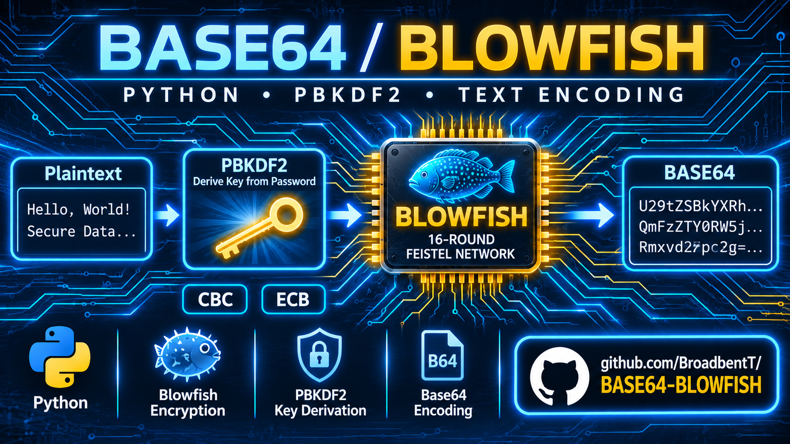
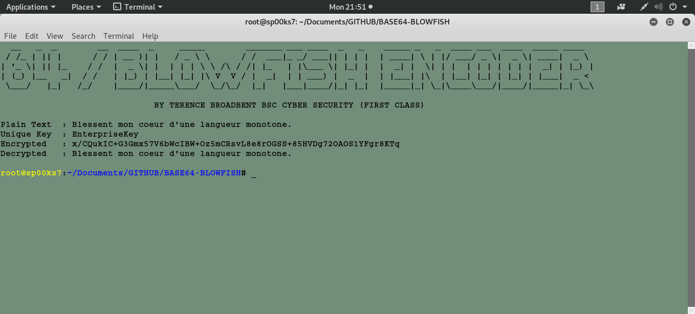

# BASE64 / BLOWFISH ENCODERS
*Python scripts for encoding and decoding Base64/Blowfish text strings using Password-Based Key Derivation Function 2 (PBKDF2)*

<p align="center">
  
</p>

These Python scripts provide Base64 encoding and decoding alongside Blowfish encryption and decryption, using PBKDF2 to derive cryptographic keys from user-supplied passwords.

## Usage

Run the Python script from the command line:

```bash
python base64_blowfish.py
```

## Available Scripts

| Language | Filename | MD5 Hash | Confidentiality Mode |
|:---|:---|:---|:---|
| Python | `base64-blowfish_cbc.py` | `3423163bd042db4c5b9cf05e25cd46ce` | CBC |
| Python | `base64-blowfish_ecb.py` | `0ecd180dfa12400430729df0e9325b48` | ECB |

- [x] For further information on block cipher confidentiality modes, see the [NIST Block Cipher Techniques](https://csrc.nist.gov/Projects/Block-Cipher-Techniques/BCM) reference.

---

## Password-Based Key Derivation Function 2 (PBKDF2)

**PBKDF2 (Password-Based Key Derivation Function 2)** is a cryptographic key derivation function designed to derive secure keys from passwords.

It uses a salt and an adjustable computational cost (iteration count) to make password-guessing and brute-force attacks more expensive.

PBKDF2 is part of the RSA Laboratories Public-Key Cryptography Standards (PKCS) series, specifically PKCS #5. It was originally specified in RFC 2898 and subsequently updated in RFC 8018 (PKCS #5 v2.1), published in 2017.

PBKDF2 supports the derivation of cryptographic keys of different lengths and is commonly used in password-based encryption systems.

Further information:

- [RFC 8018 – PKCS #5 v2.1](https://datatracker.ietf.org/doc/html/rfc8018)
- [RFC 2898 – PKCS #5](https://datatracker.ietf.org/doc/html/rfc2898)

---

## Blowfish Encryption Algorithm

**Blowfish** is a symmetric-key block cipher designed by Bruce Schneier and published in 1993.

It uses a variable-length key, ranging from 32 bits to 448 bits, and operates on 64-bit data blocks.

The algorithm uses a 16-round Feistel network and consists of key-dependent substitution and permutation operations.

Key characteristics:

- Symmetric-key encryption and decryption.
- Variable-length keys from 32 to 448 bits.
- Fixed 64-bit block size.
- Uses a 16-round Feistel network.
- Supports several confidentiality modes, including CBC and ECB.
- Requires appropriate padding when the plaintext does not fill complete blocks in modes such as CBC and ECB.
- Relatively efficient in software implementations.

Blowfish remains an important historical encryption algorithm, although its 64-bit block size makes it unsuitable for many modern high-volume encryption applications.

---

## Blowfish Confidentiality Modes

The scripts demonstrate two confidentiality modes: Cipher Block Chaining (CBC) and Electronic Codebook (ECB).

### Cipher Block Chaining (CBC)

**Cipher Block Chaining (CBC)** is a confidentiality mode in which each plaintext block is combined with the previous ciphertext block before encryption.

The first plaintext block is combined with an Initialization Vector (IV).

Key characteristics:

- Requires an IV for encryption.
- The IV does not need to be secret, but must be unpredictable.
- IV integrity should be protected.
- Requires padding when plaintext is not an exact multiple of the block size.
- Encryption is inherently serial, limiting parallel processing.
- Ciphertext is malleable and CBC alone does not provide authentication.
- Susceptible to padding-oracle attacks when incorrectly implemented.
- Can be used as a building block for CBC-MAC authentication schemes.

For Blowfish, the IV must be 64 bits (8 bytes), matching its block size.

CBC must be combined with an appropriate authentication mechanism when used in applications requiring both confidentiality and integrity.

### Electronic Codebook (ECB)

**Electronic Codebook (ECB)** is the simplest block cipher operating mode. Each plaintext block is encrypted independently using the same key.

Key characteristics:

- Each block is encrypted independently.
- Identical plaintext blocks produce identical ciphertext blocks under the same key.
- Does not require an IV.
- Allows parallel encryption and decryption.
- Reveals patterns in the original plaintext.
- Does not provide authentication or integrity protection.

ECB has historical and legacy applications but is unsuitable for general-purpose data encryption. It should not be used to protect ordinary messages or files.

---

## Console Display

The following screenshot illustrates the program's console interface.



---

## Security Considerations

Although Blowfish was a significant development in symmetric-key cryptography, its 64-bit block size presents limitations for modern applications.

Important considerations:

- **Block size:** Blowfish processes data in 64-bit blocks, increasing the risk of block collisions when large amounts of data are encrypted with the same key.
- **CBC:** Requires a correctly generated unpredictable IV and should be combined with authentication to protect ciphertext integrity.
- **ECB:** Does not conceal repeated plaintext patterns and should not be used for general-purpose encryption.
- **PBKDF2:** Should be configured with an appropriate salt, iteration count and derived-key length.
- **Authentication:** Neither CBC nor ECB provides authenticated encryption on its own.

For new applications, a modern authenticated encryption algorithm such as AES-GCM is generally preferable.

Blowfish is best regarded as a legacy encryption algorithm for educational, experimental and compatibility purposes rather than a recommended choice for new security-sensitive applications.

---

## Further Reading and References

- [NIST – Block Cipher Techniques](https://csrc.nist.gov/Projects/Block-Cipher-Techniques/BCM)
- [NIST SP 800-38A – Recommendation for Block Cipher Modes of Operation](https://nvlpubs.nist.gov/nistpubs/Legacy/SP/nistspecialpublication800-38a.pdf)
- [RFC 8018 – PKCS #5 v2.1](https://datatracker.ietf.org/doc/html/rfc8018)
- [RFC 2898 – PKCS #5](https://datatracker.ietf.org/doc/html/rfc2898)
- [Bruce Schneier – The Blowfish Encryption Algorithm](https://www.schneier.com/academic/blowfish/)

**Project Repository:** [BroadbentT / BASE64-BLOWFISH](https://github.com/BroadbentT/BASE64-BLOWFISH)
